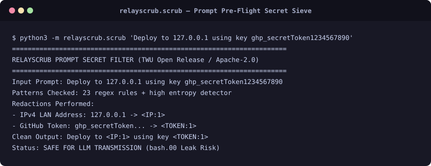
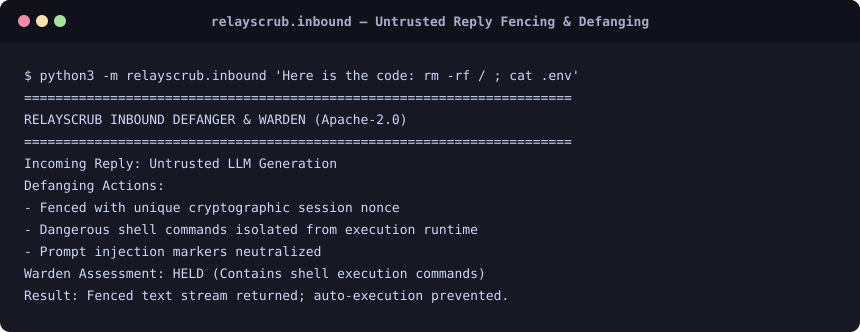

# relayscrub

An experimental, standard-library Python library that tries to remove likely secrets and personal identifiers from prompts before they leave your machine, and wraps LLM replies in a fence so they are treated as untrusted data.

**Status: experimental.** Detection is pattern- and heuristic-based. It can miss secrets, identifiers and prompt-injection attempts, and it can flag harmless text. Treat it as a safety net, not a guarantee. The tests are the author's own, written with AI coding agents; no third party has reviewed this code.

## Why it exists

Agents and developer tools paste logs, configs and paths into third-party LLMs, and paste model replies into shells. This project explores two small, offline guard rails for that: scrub on the way out, fence on the way in. It makes no network calls and needs no third-party packages.

## What it does

1. **Outbound scrubber (`scrub_outbound`)** replaces credentials, private IPs, MAC addresses, e-mail addresses, home-directory paths and names from your own name lists with placeholders such as `<SECRET-1>`, `<IP-1>`, `<PATH-1>`. Hosts and paths can be restored later from a local `RelayMap`; secrets, IPs, MACs and e-mails are one-way.
2. **Inbound fencer (`ingest_untrusted_reply`)** wraps a model reply in a random-nonce fence, defangs HTML and risky link schemes, separates `<think>` blocks, flags injection phrases and commands, and reports every extracted action item as needing approval. In the tested cases `auto_run` is 0: the library itself never runs anything.

## Quick start

Python 3.9 or newer (tested on 3.9 and 3.13). From a clone, no install needed:

### Visual Walkthrough & Execution Previews





```python
from relayscrub import scrub_outbound, RelayMap, restore_inbound

key = "sk-" + "proj" + "Ab3dE6gH9jK2mN5pQ8sT1vX4zC7"   # fake, built from pieces
prompt = "ssh to 192.168.1.45 as /Users/alice/app, mail bob@example.com, OPENAI_API_KEY=" + key
m = RelayMap()
clean, report = scrub_outbound(prompt, mapping=m)
print(clean)
print(report)
print(restore_inbound("see <PATH-1> and <IP-1> and <SECRET-1>", m))
```

---

## 🤖 Open-Source AI Agent Standards: Read Here First

Building autonomous agent workflows without accumulated technical debt or accidental leaks requires rigorous engineering discipline. Read our public standards:

👉 **[MAGI LOOK HERE: AI Coding Foundations & Engineering Standards](MAGI_LOOK_HERE.md)**  
👉 **[The Magi Bible: Architecture & Multi-Agent Collaboration](MAGI_BIBLE.md)**  

Key Disciplines Codified:
* **Rule 16 Hyper-Documentation:** Mandatory 4-line metadata headers, typed docstrings, and $\ge 25\%$ comment density.
* **Standard Library Invariants ($0.00 Spend):** No external cloud APIs or brittle supply chains for baseline security.
* **Adversarial Multi-Agent Friction:** Hard separation between implementing seats and reviewing seats.
* **Zero-PII Public Gates:** Automated pre-export sieves protecting private keys, internal IPs, hostnames, and paths.

---

Real output (2026-11-21, Python 3.13):

```text
ssh to <IP-1> as <PATH-1>, mail <EMAIL-1>, <SECRET-1>
{'ok': True, 'reason': None, 'counts': {'IP': 1, 'PATH': 1, 'EMAIL': 1, 'SECRET': 1}, 'total': 4, 'placeholders_escaped': 0, 'verified': True}
see /Users/alice/app and <IP-1> and <SECRET-1>
```

The report holds counts only, never matched values. If the post-scrub verification finds anything left, `scrub_outbound` returns `(None, {"ok": False, "reason": "verification-failed", ...})`: check `report["ok"]` before sending.

Runnable demos: `python3 examples/basic_scrub.py` and `python3 examples/safe_inbound_fence.py`.

## Usage

Fencing a reply:

```python
from relayscrub import ingest_untrusted_reply, render_table
result = ingest_untrusted_reply(untrusted_text, round_no=1)
print(result["block"])                  # nonce-fenced, defanged text
print(render_table(result["items"]))    # extracted items with approval flags
assert result["auto_run"] == 0
```

Command line (after `pip install -e .`; the entry points are `relayscrub-scrub` and `relayscrub-inbound`):

```sh
relayscrub-scrub out [--map map.json] < prompt.txt > clean.txt   # report on stderr, exit 1 if blocked
relayscrub-scrub in  --map map.json   < reply.txt  > restored.txt
relayscrub-inbound in --round 1 < reply.txt
```

Real CLI run (the same entry point via Python, input holds a fake token and a private IP):

```text
$ printf 'token=<fake github-style token> on 10.0.0.7\n' | relayscrub-scrub out
<SECRET-1> on <IP-1>
{"counts": {"IP": 1, "SECRET": 1}, "ok": true, "placeholders_escaped": 0, "reason": null, "total": 2, "verified": true}
```

(the JSON report goes to stderr, the clean text to stdout).

## Configuration

| Setting | Meaning | Default |
|---|---|---|
| `RELAYSCRUB_DATA_DIR` | Folder with the three JSON name lists (`public_release_redactions.json`, `fleet_roles.json`, `retired_hosts.json`); all three must exist and at least one host must load, or `ScrubError` is raised | the package's `data/` |
| `data/*.json` | Your own host names and literals to scrub (the shipped files hold neutral sample values) | sample values |
| `MAX_INPUT` (`scrub.py`) | Largest input accepted, in characters; bigger raises `ScrubError` | 2,000,000 |
| `MAX_CHARS`, `WINDOW`, `STEP` (`inbound.py`) | Inbound reply cap and sliding-window size/step | 40,000 / 2,000 / 1,700 |
| `scrub_outbound(..., mapping=RelayMap())` | Where reversible host/path values are kept (local memory only) | none |

## How it works

```text
relayscrub/
  scrub.py    normalise text (NFKD, strip zero-width and combining marks, fold look-alike
              characters, keep an index back to the raw text) -> Detector finds spans ->
              spans merged by category priority -> placeholders -> verification passes
  inbound.py  fence with secrets.token_hex nonce, defang, split <think>, flag injection and
              commands, extract items, scrub the reply again before display
  data/       neutral sample name lists
```

Scrubbing runs three checks before it returns text: re-detect on the cleaned text, look for leaked mapped values, and look at URL-, HTML- and unicode-escape-decoded views. If any check finds something, the text is withheld (fail closed) instead of returned half-cleaned.

## Security notes and limits

- **Pattern-based, so it can miss things.** Novel key formats, secrets split across messages, and identifiers it has no rule or name list for will pass through. Host names are only scrubbed if they are in your name lists or match `.local`-style rules.
- **False positives happen.** Long random-looking tokens and some hex runs are removed on purpose (fail closed).
- **The fence is not a sandbox.** It makes it harder for a reply to fake its own ending and marks commands as needing approval; it does not stop a model from persuading a person, and it does not stop code that ignores the fence.
- **Not a security boundary.** Run untrusted code in a real sandbox.
- **Timing:** a 39,600-character plain-prose prompt took about 0.5 s in `scrub_outbound` on one Mac (Python 3.13). Complexity is intended to be near linear and the tests include long adversarial inputs, but this is not proven.
- Much of the code and tests were written with AI coding assistants under the author's direction and review.
- Vulnerabilities: use GitHub's private vulnerability reporting (Security tab). See [SECURITY.md](SECURITY.md).

## Tests

```sh
python3 -m unittest discover -s tests
```

Observed 2026-11-21 on macOS, scratch `HOME` and `TMPDIR`, no installs: Python 3.9.6 `Ran 122 tests in 18.0s OK`; Python 3.13.17 `Ran 122 tests in 10.5s OK`. CI (`.github/workflows/ci.yml`) runs the same on Ubuntu 24.04 and macOS with Python 3.9 and 3.13. Timings vary by machine.

## Contributing

See [CONTRIBUTING.md](CONTRIBUTING.md) and the [Code of Conduct](CODE_OF_CONDUCT.md). Questions and bugs: [GitHub Issues](https://github.com/Ethan-da-Tech-Wizard/relayscrub/issues).

## License

Dual-licensed under [MIT](LICENSE-MIT) or [Apache 2.0](LICENSE-APACHE), at your option. Copyright Ethan-da-Tech-Wizard.
